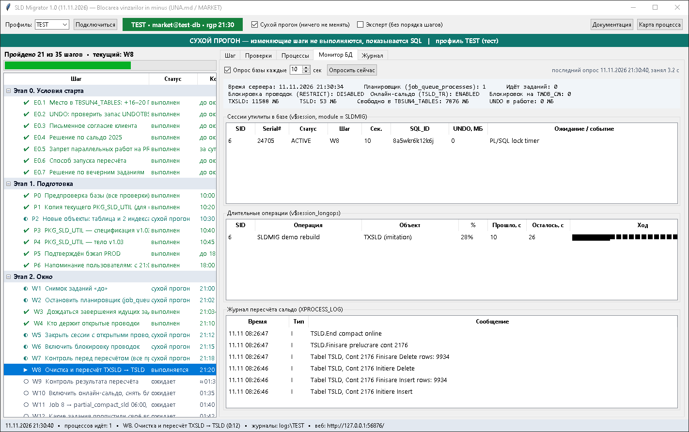
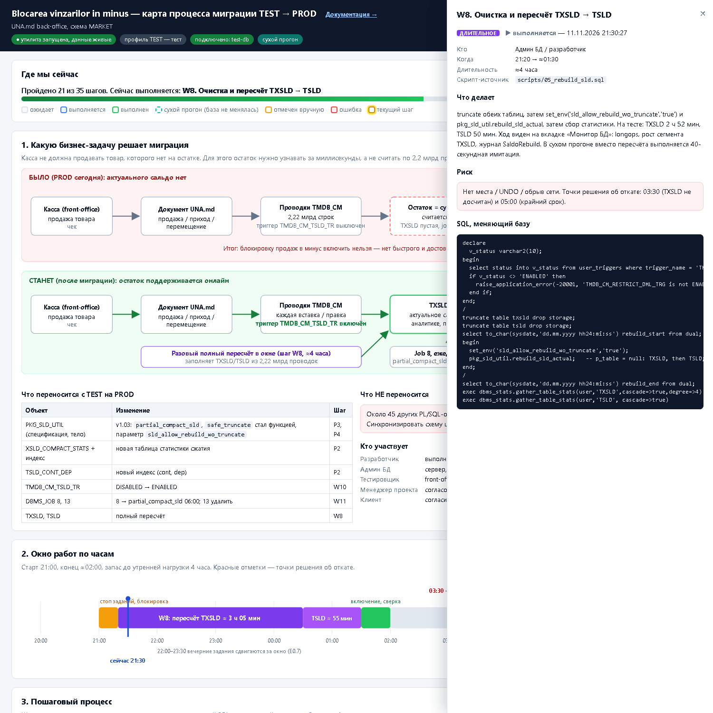

# SLD Migrator

Утилита с окном (Python, tkinter) для пошагового переноса «блокировки продаж в минус»
с тестовой базы Oracle на продуктивную (UNA.md back-office).

**[Руководство пользователя со снимками экрана](https://paveltuhari.github.io/sld-migrator/)** ·
[Полная документация](https://paveltuhari.github.io/sld-migrator/documentation.html) ·
[Карта процесса](https://paveltuhari.github.io/sld-migrator/process_map.html)

## Скачать

| Файл | Что это |
|---|---|
| [sld-migrator-setup.exe](https://github.com/PavelTuhari/sld-migrator/releases/latest/download/sld-migrator-setup.exe) | самораспаковывающийся архив для Windows |
| [sld-migrator.zip](https://github.com/PavelTuhari/sld-migrator/releases/latest/download/sld-migrator.zip) | то же содержимое обычным архивом |

В архиве: программа на Python, SQL-скрипты, документация и снимки экрана.

## Запуск

1. Нужны Python 3.8+ для Windows и Oracle sqlplus. Дополнительные пакеты не нужны.
2. Распакуйте архив.
3. Заполните `sld_migrator/sld_migrator.ini`: путь к sqlplus, `dsn`, `user`, `expected_host` для профилей TEST и PROD.
4. Запустите `sld_migrator/run.bat`, выберите профиль, нажмите «Подключиться».

По умолчанию включён сухой прогон: проверки выполняются, изменяющие шаги только показывают SQL.

## Возможности

- 36 шагов по этапам: условия старта, подготовка, окно, после окна, откат. Текущий шаг помечен «вы здесь».
- Асинхронный запуск: каждый шаг — отдельный процесс sqlplus, окно не блокируется.
- Монитор базы: триггеры, планировщик, блокировки, размер таблиц сальдо, `v$session_longops`, журнал пересчёта.
- Удержание соединения на многочасовом шаге пересчёта (TCP keepalive через локальный порт): сетевое оборудование не рвёт молчащее соединение.
- 36 проверок с ожиданиями для стадий «до», «окно», «после».
- Встроенные HTML-страницы: документация и карта бизнес-процесса с живыми статусами.
- Защита продуктивной базы: проверка имени сервера перед каждым запуском, подтверждение словом `PROD`.

## Состав

| Папка | Содержимое |
|---|---|
| `sld_migrator/` | программа, настройки, `run.bat` |
| `scripts/` | SQL-скрипты миграции `00`–`08`, `99` |
| `docs/` | руководство, документация, карта процесса, снимки экрана |

## Состояние проверки

Версия 1.2 (12.11.2026). На тестовой базе пройдены сухой прогон и боевой прогон всех шагов, включая полный пересчёт сальдо
по 2,08 млрд проводок (2 ч 35 мин); суммы по всем счетам совпали с состоянием до пересчёта. Пересчёт удался со второй попытки:
первая оборвалась на 120-й минуте из-за разрыва молчащего соединения, после чего добавлено удержание соединения.

Первое ежедневное сжатие после пересчёта идёт дольше обычного: на тестовой базе за 3 ч 46 мин оно не закончилось
(обычный прогон — 2 ч 20–35 мин), ошибок не было. Таблица сальдо за это утро выросла с 7,5 до 11,1 ГБ.
Место нужно сразу, а сжатие идёт в рабочие часы. Версия 1.2 отличается от 1.1 только этим предупреждением в текстах;
команды шагов не менялись, снимки экрана сняты версией 1.1.

Не выполнялись: откат, принудительное закрытие чужих сессий, установка пакета на базу, где его ещё нет.
Первое сжатие после пересчёта наблюдалось не до конца.
На продуктивной базе утилита запускалась только в сухом прогоне.
